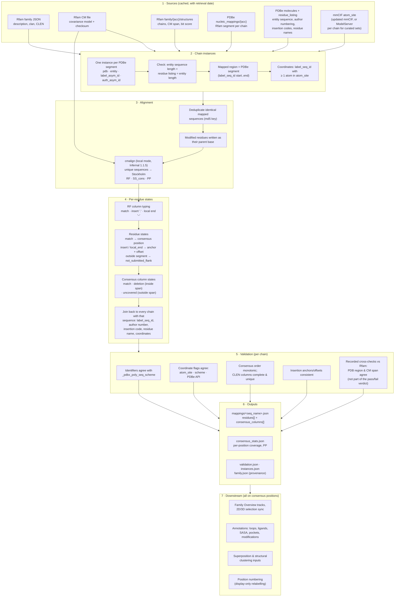

# Mapping PDB RNA structures onto Rfam families

How the Aggregated RNA 3D View places every nucleotide of an experimentally determined RNA chain on the coordinate system of its Rfam family, and what that mapping can and cannot tell you.

*Pipeline version 0.1.0 · Rfam 15.1 · Infernal 1.1.5 · code in `rna_explorer/` (`pipeline.py`, `sequences.py`, `infernal.py`, `stockholm.py`, `mapping.py`, `validation.py`, `confidence.py`).*

---

## 1. The idea in one paragraph

Every Rfam family has a covariance model (CM): a probabilistic profile of the family's sequence and secondary structure. The model has **CLEN consensus (match) positions**. For example, the purine riboswitch RF00167 has CLEN = 102 and bacterial 16S rRNA RF00177 has CLEN = 1,533.

We align the Rfam-annotated region of each PDB RNA chain to that model with Infernal `cmalign`. Each aligned nucleotide is then either assigned to a consensus position or explicitly marked as not having one.

The consensus positions then act as a **shared coordinate system**: position 50 means "the nucleotide that occupies consensus column 50" in every structure. This holds whatever the chain's own numbering and whatever its length. All aggregation in the app (coverage, annotations, loops, ligand contacts, SASA, pockets, clustering inputs) is computed on these positions.

---

## 2. Workflow

---

## 3. Step by step

### 3.1 Which chains belong to a family

- **Default build:**
  - **Chains:** every chain segment that PDBe annotates with the family (`PDBe API v2 nucleic_mappings/{acc}`). PDBe's annotation is itself derived from Rfam's search of the PDB.
  - **Segment:** we take PDBe's start/end (`label_seq_id`) as the **mapped region**; only this region is aligned.
- **Curated build** (`build --selection CSV`; used for 16S, 60 chosen chains):
  - **Chains:** the listed `(pdb_id, label_asym_id)` pairs. A chain is kept only if PDBe has exactly one segment of that family on it.
  - **Coordinates:** read per chain from the PDBe ModelServer (first model); the full-entry mmCIF is never stored.
- **Rejected inputs:** chains whose PDBe entity sequence, residue listing and entity length disagree are skipped with a recorded reason. No family has needed this so far.

Each instance is identified by `seq_name = <pdb>_<entity>_<auth_asym_id>_<label_asym_id>`. Internally every residue is addressed by `label_asym_id` + `label_seq_id`. Author numbering is carried along for display only.

### 3.2 Alignment

1. **Deduplication.** Chains with an identical mapped sequence are aligned once (md5 of the sequence). Many PDB entries are the same construct with different ligands or conditions, so this saves time. It also guarantees that identical sequences receive identical consensus positions. Current counts:

   | Family | Unique sequences | Chains |
   |---|---|---|
   | RF00167 | 29 | 84 |
   | RF00162 | 23 | 29 |
   | RF00059 | 5 | 38 |
   | RF00177 | 15 | 60 |

2. **Modified nucleotides.** These (e.g. PSU, 2MG, 5MC) are written as their parent base from the PDBe one-letter sequence. Their real identity is kept in the residue record.
3. **`cmalign`, local mode.** Infernal's default allows the model to start and end anywhere and to skip internal regions, called "local ends". We use local mode because global mode forces a chain end-to-end through the whole model; in the 16S proof of concept, the divergent mitochondrial rRNA alignments collapsed under global mode.
4. **Output** (a Stockholm alignment) contains:
   - `#=GC RF`: the consensus line. Match columns carry a letter; insert columns `.`; local-end columns `~`.
   - `#=GC SS_cons`: the consensus secondary structure.
   - `#=GR PP`: the posterior probability of each aligned nucleotide, in bins `*` (≥ 0.95), `9` … `0`.
   - A score file with the bit score, average PP, CM span and truncation flag.

### 3.3 Turning the alignment into states

**Every nucleotide** of a chain gets exactly one state:

| State | Meaning | Consensus position |
|---|---|---|
| `match` | aligned to a consensus column | **yes**: 1..CLEN |
| `insert` | extra nucleotide between two consensus columns | no; *anchor* (preceding consensus position, 0 = before position 1) + *offset* (1, 2, …) |
| `local_end` | skipped by a local-end jump (part of the chain the model treats as not homologous) | no; anchor + offset |
| `not_submitted_flank` | outside the PDBe-mapped region (tags, scaffolds, adjacent RNA) | no |

**Every consensus position** gets exactly one state per chain:

| State | Meaning |
|---|---|
| `match` | one nucleotide of the chain occupies it (`polymer_seq_position` given) |
| `deletion` | inside the chain's aligned span, but the chain has no nucleotide there |
| `uncovered` | outside the chain's aligned span (the structure starts later or ends earlier) |

Then each unique-sequence alignment is joined back to every chain that shares it. This adds the chain's own `label_seq_id`, author residue number, insertion code, residue name, modification flag and **coordinate availability**. A residue has coordinates if at least one atom with that `label_seq_id` is present in `atom_site`.

Coordinate availability is independent of the alignment state. A nucleotide can be a perfect `match` with no coordinates (disordered in the crystal). The app shows that as "Coordinates unavailable", never as a deletion.

### 3.4 Validation

Each chain mapping is checked before export (`validation.json`). The mapping is accepted (`ok`) only when all of the following hold:

1. **Identifiers agree with the mmCIF** `_pdbx_poly_seq_scheme`: chain ids, entity, author residue number, insertion code and residue name for every residue.
2. **Coordinate flags agree** across three sources: our `atom_site` scan, the scheme's modelled flag, and PDBe's observed ratio.
3. **Consensus positions increase monotonically** along the chain (no crossing).
4. **All CLEN consensus columns are present exactly once** in the chain's column table.
5. **Insertion bookkeeping is consistent:** offsets count 1, 2, 3 … after each anchor, and no anchor lies before the previous match.

Two further checks against Rfam are recorded, but are not part of the `ok` verdict:
- the PDB region agrees with Rfam's `structures` endpoint;
- the CM span agrees with Rfam's own hit.

Current status: all chains pass, and both Rfam cross-checks agree for every chain.

| Family | CLEN | PDB entries | Chains | Validated | Region agrees with Rfam |
|---|---|---|---|---|---|
| RF00167 purine riboswitch | 102 | 66 | 84 | 84 | 84 |
| RF00162 SAM-I riboswitch | 108 | 28 | 29 | 29 | 29 |
| RF00059 TPP riboswitch | 105 | 28 | 38 | 38 | 38 |
| RF00177 16S rRNA (curated 60) | 1,533 | 58 | 60 | 60 | 60 |

Independent check (16S proof of concept): against the BGSU RNA 3D Hub chain alignments for 14 chain pairs, our consensus correspondence had 100 % precision and 99 % recall. BGSU's only extra pairs were coincidences inside insert or local-end regions.

### 3.5 Per-position statistics

There are two denominators, and they are never mixed:

- **Sequence level.** Of the *unique* mapped sequences, how many have a match at the position. This answers whether the family's sequences contain the nucleotide, without being weighted by how often one construct was crystallised.
- **Structure level.** Of the *chain instances*, how many have a match **with coordinates** at the position. This answers whether we can see it in 3D.

Mean posterior probability per position is reported as an alignment-confidence track. The display bands (high ≥ 0.95, medium ≥ 0.80, on bin midpoints) are provisional. **No composite confidence score is computed.**

### 3.6 What the frontend does with it

- **Selection sync.** A click on consensus position *p* is translated per chain through `consensus_columns[p]` → `polymer_seq_position` → that residue in 2D and 3D. Deleted, uncovered and coordinate-less positions are reported and never highlighted.
- **Loops and insertions.**
  - A loop selection uses its own BGSU nucleotide list, not a consensus range.
  - Insertions appear as `+N` markers *between* columns. They never become extra columns.
- **Position numbering** (display only). Labels can show any chain's author numbers. The lookup is consensus position → that chain's match residue → `residue_name` + `author_residue_number` + `insertion_code`. There is no offset arithmetic, and no number is invented where the chain has no match.

---

## 4. Worked example

**1Y26 chain X**, *Vibrio vulnificus* adenine riboswitch, RF00167:

| | Value |
|---|---|
| Chain length | 71 nt (author numbering starts at 13) |
| PDBe-mapped region | `label_seq_id` 3–69 → 67 nt aligned |
| CM span (`cmalign`) | consensus 19–87; bit score 63.4, average PP 0.999 |
| Residues | 67 `match`, 0 `insert`, 0 `local_end`; 4 `not_submitted_flank` (2 at each end) |
| Consensus columns | 67 `match` + 2 `deletion` (positions 64 and 72, inside 19–87) + 33 `uncovered` (1–18 and 88–102) = 102 |
| Example | consensus 50 → `label_seq_id` 34 → author G46, coordinates present |

So for this chain, position 64 is a **deletion** (the family has a nucleotide there, this construct does not), while position 5 is **uncovered** (the construct simply starts later in the model). The two are reported differently.

---

## 5. Design decisions and why

| Decision | Reason |
|---|---|
| Align only the PDBe-mapped segment | Flanking tags, scaffolds and neighbouring RNAs are not homologous to the model and would distort a local alignment; they are kept as `not_submitted_flank` |
| Local mode, not global | Allows fragments, truncated constructs and divergent sequences to align where they are homologous instead of being forced end-to-end |
| Only `match` gets a consensus position | A consensus position must mean the same column in every chain; inserted nucleotides have no counterpart in other chains |
| Insertions as anchor + offset, local ends as a separate state | Keeps every nucleotide accounted for and locatable without inventing positions |
| Coordinates as an independent flag | Separates "missing from the sequence" (deletion) from "present but not modelled" |
| Deduplicate before aligning | Identical sequences must get identical positions; also cheaper |
| `label_*` identifiers internally, author numbering for display | Author numbering can skip, repeat with insertion codes, or start anywhere; `label_seq_id` is guaranteed sequential |
| Keep flagged or excluded observations in the data | Excluded is not the same as absent, and downstream users can re-decide |
| Provenance on every file | Rfam release, CM checksum, Infernal version, options, pipeline version, sources and dates |

---

## 6. Limitations and caveats

### Alignment model
1. **A consensus match is sequence/structure-model homology, not 3D equivalence.** Two nucleotides at the same consensus position may sit in different conformations, as in apo vs ligand-bound states or a rotated 16S head. Structural comparison is a separate analysis.
2. **The CM aligns sequence + consensus secondary structure; it does not see the 3D coordinates.** In variable regions, such as long hairpins, expansion segments and divergent loops, nucleotides can be placed in a neighbouring column with low posterior probability. Low-PP matches are still matches; check the alignment-confidence track and `posterior_prob` in the mapping file.
3. **Local-mode ends.** Residues skipped by a local-end jump have no consensus position, even when parts are structurally homologous. A family with highly divergent members can therefore look less covered than it is.
4. **Modified nucleotides are aligned as their parent base.** This is usually correct, but the alignment cannot use the modification itself, and an unusual parent assignment would propagate.

### Coverage of the family
5. **We depend on PDBe's Rfam annotation for membership and segment boundaries.** Chains PDBe does not annotate, or annotates with a truncated segment, are missed or partly mapped. The segment boundaries also bound what we align.
6. **Release synchronisation.** No automated check confirms that the Rfam release behind PDBe's annotation equals the CM release we align to. The evidence that they agree is the region and CM-span cross-check, currently 100 %.
7. **Curated subsets are not exhaustive.** RF00177 uses 60 chosen 16S chains, not all of the roughly 1,500 ribosome entries. Its statistics describe that selection.
8. **Clan competition.** A chain can also be hit by a sibling family in the same clan, e.g. human 18S rRNA hit by RF00177. We record whether the family is the chain's best clan hit; non-best chains are flagged, not silently mixed in.
9. **Engineered constructs.** Scaffold-embedded, chimeric and synthetic constructs are included if PDBe maps them. The scaffold part stays outside the mapped region. Labels such as "synthetic construct" come from the deposition.

### Structures and coordinates
10. **"Has coordinates" means at least one atom.** A nucleotide with only a phosphate modelled counts as present. Atom-level completeness is handled separately where it matters: SASA counts only complete nucleotides.
11. **One model per chain.** NMR ensembles and multi-model entries use model 1. Multiple copies of a chain in an entry are separate instances, which weights entries with many copies more heavily at the structure level.
12. **Entity-level annotations** (e.g. some PDBe ligand sites) cannot always be attributed to a specific copy; see the annotation reports.

### Interpretation
13. **Insertions and local-end residues are outside per-position aggregation.** They are shown as markers and listed per chain, but they do not contribute to coverage or annotation frequencies at any position.
14. **Two denominators.** Sequence-level fractions (unique sequences) and structure-level fractions (chains with coordinates) answer different questions; do not compare them directly.
15. **Author numbering is display only.** It may be discontinuous, carry insertion codes (e.g. 9C6J A: 306, 306A, 306B …), or be non-monotonic. Never use it for arithmetic. The app's Position numbering relabels axes but always computes on consensus positions.
16. **Provisional thresholds.** PP display bands and representative-structure rules are documented choices, not established standards.

---

## 7. Where to look

| Question | File |
|---|---|
| Where does nucleotide X of chain Y map? | `data/families/<ACC>/mappings/<seq_name>.json` → `residues[]` |
| What does chain Y have at consensus position *p*? | same file → `consensus_columns[p-1]` |
| Did chain Y pass validation, and what was checked? | `data/families/<ACC>/validation.json` |
| Per-position coverage and confidence | `data/families/<ACC>/consensus_stats.json` |
| Release, CM checksum, Infernal options, sources | `provenance` in `family.json` and every mapping file |
| JSON schemas | `rna_explorer/schemas/mapping.schema.json` and siblings |
| Rebuild a family | `python3 -m rna_explorer build <ACC> --cpu 4 -v` (`--selection CSV` for a curated set) |
